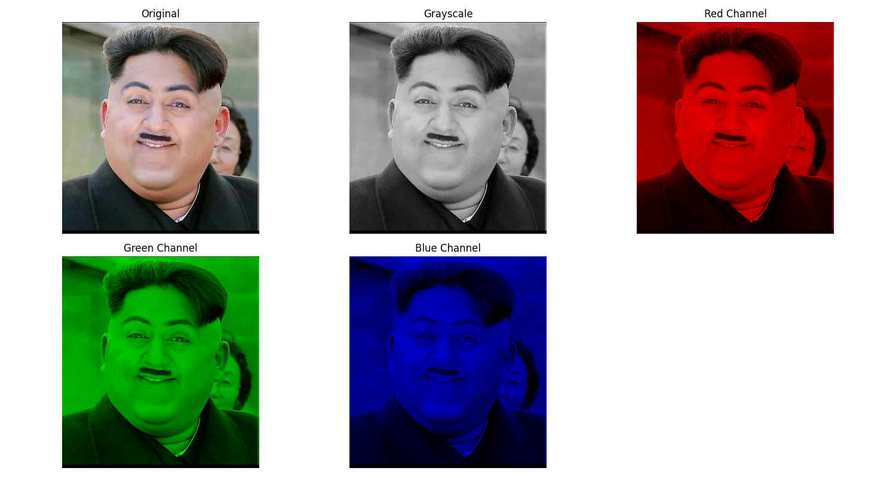

# DIP Lab 1 – Grayscale and RGB Channel Extraction

## Task
Take an input color image and generate:
1. Grayscale image
2. Red channel image
3. Green channel image
4. Blue channel image

## Method
- Loaded the image using OpenCV (`cv2.imread`).
- Converted BGR → grayscale using `cv2.cvtColor(img, cv2.COLOR_BGR2GRAY)`.
- Split the image into its B, G, R channels using `cv2.split()`.
- Reconstructed single-channel "resolution" images by zeroing out the other two channels and merging back with `cv2.merge()`, so each channel is visualized in its own true color.
- Displayed all five images (original, grayscale, red, green, blue) in a single figure using Matplotlib and saved it as `output.png`.

## Files
| File | Description |
|---|---|
| `grey_conversion_script.py` | Main Python script |
| `input.jpg` | Sample input color image |
| `output.png` | Output showing all 5 results |

## How to Run
```bash
pip install opencv-python matplotlib numpy
python grey_conversion_script.py
```

## Output


## Requirements
- Python 3.x
- OpenCV (`opencv-python`)
- NumPy
- Matplotlib
